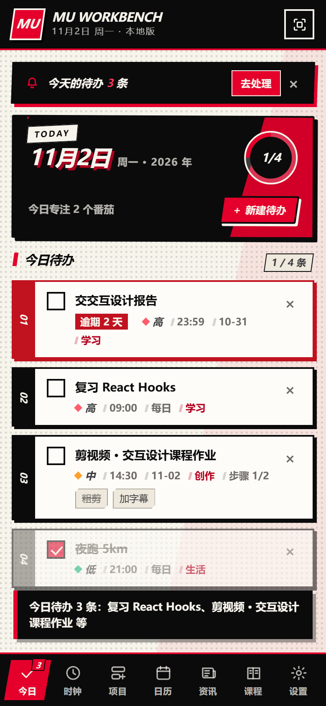
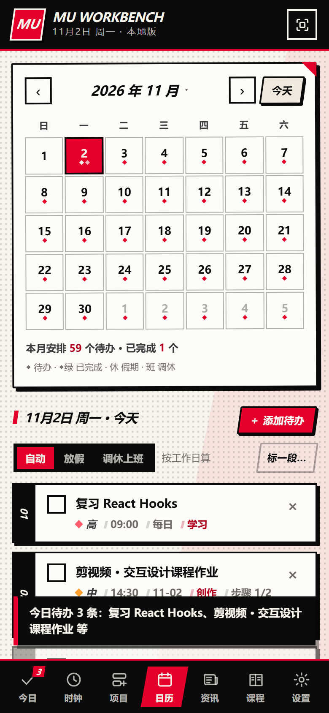
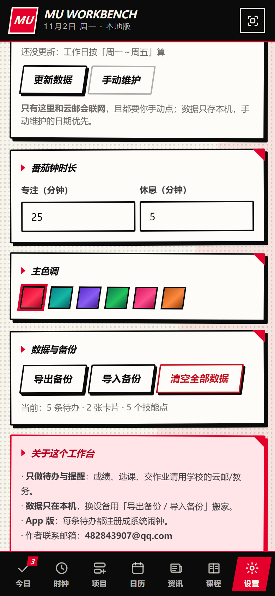
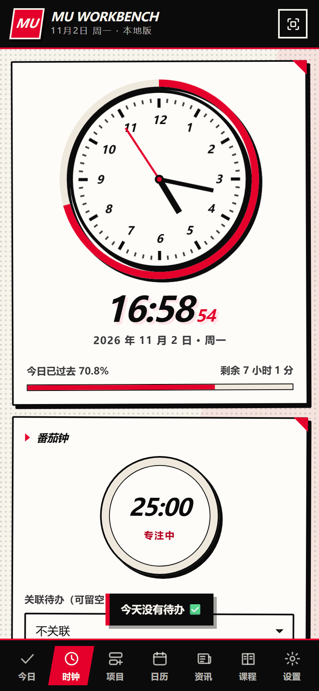
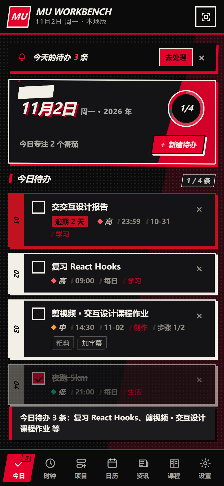
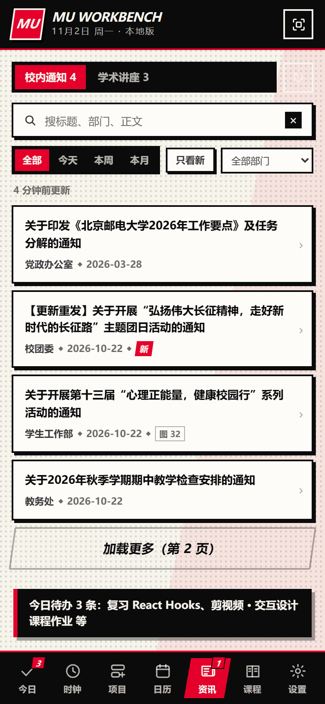
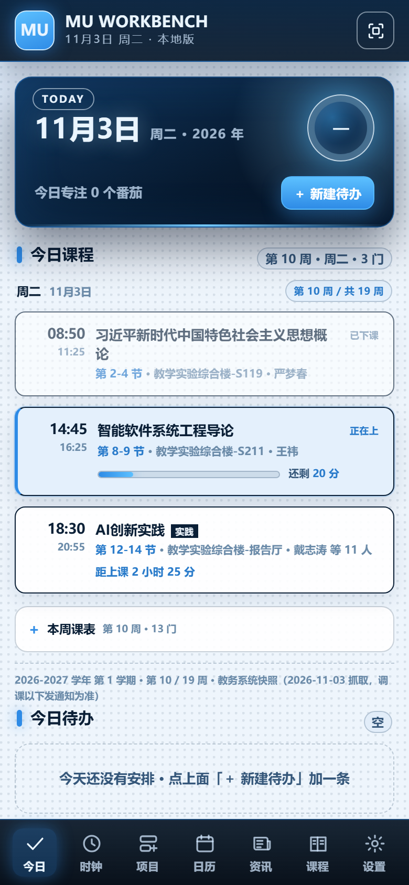
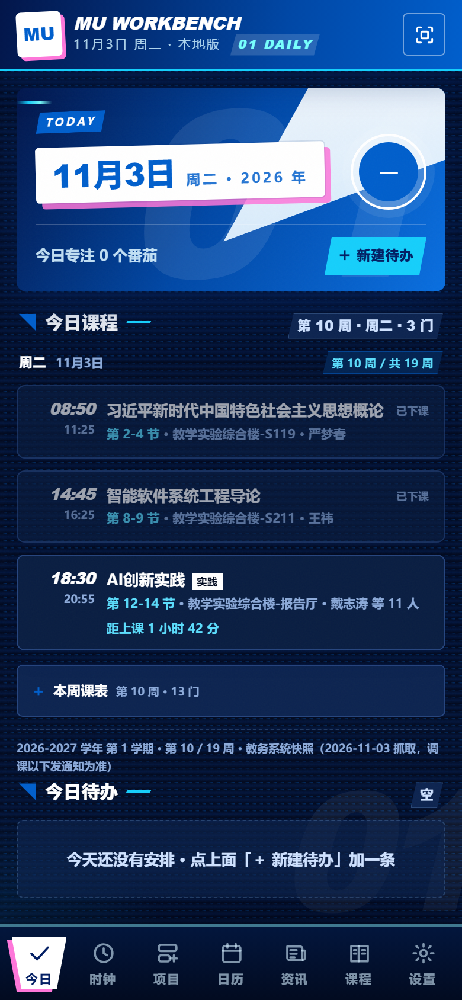
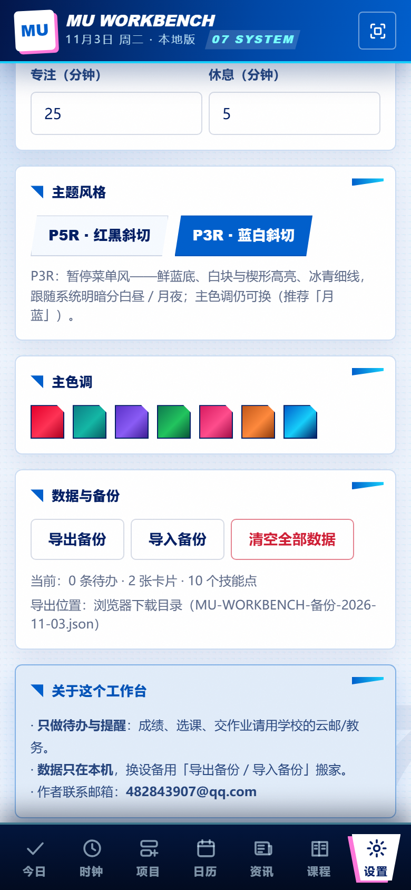
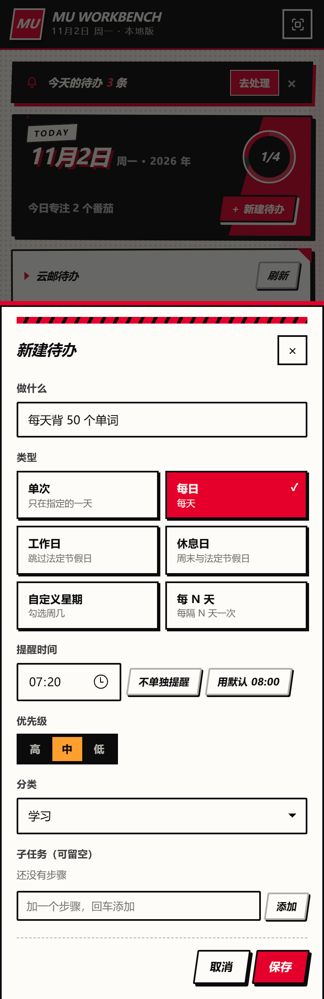

# MU WORKBENCH

> 一个**完全离线**的个人工作台安卓 App：今日待办、可视化时钟、番茄钟、项目进度、日历、校内资讯、课程性价比与课外加分。
> 单文件 HTML（HTML + CSS + JS 全内联，零外部依赖），用 Capacitor 套一层安卓外壳打成 APK。

<p align="center">
  
  
  
</p>

## 这是什么

- **只做个人待办与提醒**。查成绩、选课、交作业请用学校更全的云邮 / 教务系统；这里只把「今天要做什么」摊平。
- **数据只在本机**。默认不联网、不上传、没有后端、没有账号体系；所有数据存在 WebView 的 `localStorage`（键名 `mu_workbench_v1`），换设备用「导出备份 / 导入备份」搬家（App 版导出到手机 `下载/MU WORKBENCH/`，网页版走浏览器下载目录）。
- **只有三处会联网，且都要你手动点**：更新节假日数据、同步云邮待办、更新教务课表（默认用内置快照，不填账号就完全不联网）。
- 云邮 / 信息门户是**附加功能**：要输入学工号密码，凭据只存本机、可随时清除，且只用于登录与读取，不发送任何提交或写入请求。

## 功能

| 模块 | 说明 |
|---|---|
| **今日** | 今日待办列表；逾期任务自动顺延并在原位划掉；顶部提醒横幅；右下角 `＋ 新建待办`；云邮待办卡片**标出所属课程**（接口不带课程，App 按课程表反查并缓存） |
| **课表** | 今日课程卡（现在上 / 下一节 / 剩余时间 / 本周课表）；默认用内置快照，设置里填**教务系统自己的账号密码**可在线更新（账密与云邮分开） |
| **待办类型** | 单次 / 每日 / 工作日（跳法定节假日）/ 休息日 / 自定义星期 / 每月几号（多选 1–31 日，没这天的月份自动跳过）/ 每 N 天；可逐条设优先级、分类、提醒时间、子步骤 |
| **提醒** | App 版把每条待办注册成**系统闹钟**（不是页面里的定时器），可设汇总兜底提醒、提示音三档音量、精确闹钟权限 |
| **时钟** | 表盘 + 数字时钟 + 今日进度；番茄钟（可关联待办，云邮待办也能关联）；秒表 / 倒计时 |
| **项目** | 可自建的进度卡片，每张卡下挂若干技能点，各自带进度条 |
| **日历** | 月历 + 年月快选 + 节假日 / 调休标记 + 长按加待办 + 给一段日期标「放假 / 调休上班」 |
| **资讯** | 校内通知 / 学术讲座（信息门户，只读），支持搜索、按时间与部门筛、打开看正文与附件 |
| **课程** | 培养方案课程性价比（按学时 / 学分 / 考核方式排序），课外加分记账与计分器、114 项竞赛清单；**扫码签到**（相机窗口，可点「再扫一次」连续扫）；**作业档案**（按学期归档已提交作业，含批改 / 我的作业 / 优秀作业，附件可预览、可下载） |
| **后台检查** | 约每 15 分钟用**已登录的令牌**复查云邮新作业与校内新通知，发现新的就发系统通知——不用一直开着 App |
| **设置** | 提醒、皮肤（P5R / P3R）与主题色、番茄钟时长、数据备份、云邮凭据、教务课表账号、后台常驻 |

## 通知能有多快

这个 App 没有服务器、也不上传数据，所以「立刻知道」只能靠手机自己去问学校服务器。分三种情况：

| 场景 | 最快多久 | 靠什么 |
|---|---|---|
| 待办**到点**提醒 | **准点（秒级）** | 每条待办注册成系统**精确闹钟**，JS 被系统冻结也照响 |
| 云邮**新作业/新测验** | 约 **15 分钟**（省电模式下可能更久） | WorkManager 定期任务 + `refresh_token` 换新令牌后拉列表 |
| 校内**新通知/讲座** | 约 **15 分钟** | 复用资讯页的会话 cookie 拉列表 |

**为什么不是秒级**：Android 对后台任务的硬限制就是 WorkManager 最小 15 分钟一次；真要秒级只能靠服务器推送，那要求把凭据放到服务器上，与「数据只在本机」冲突，所以没做。

**云邮不重登，门户会重登**：

- **云邮**：只用 `access_token`，过期用 `refresh_token` 换（不走密码、不计登录失败次数）；换不动就提示打开 App。
- **门户**（`my.bupt.edu.cn`）：列表页要登录态，而它的会话在 App 里由 CapacitorHttp 持有（进程被杀就没了），所以后台干脆**自己登录**——会话失效时用云邮那组学工号密码走一遍 CAS（门户风控很松），会话缓存 6 小时复用，登录失败冷却 30 分钟，不会反复打。

**代价要说清楚**：因为门户会话失效时要自动重登，**学工号密码也会存到原生侧的本机存储里**（和 App 里一样是明文、只在本机、不发出去）。关掉「后台检查」或清除云邮凭据会一并清掉。

会话过期属于正常状态，不会被算成「连续失败」，也不会反复弹提示。

**怎么开**：设置 →「后台检查新内容」→ 打开总开关（默认关）。里面还能单独关掉云邮 / 资讯，或限制「只在 Wi-Fi 下检查」。首次开启建议先点一次「立即检查一次」，确认通知能正常弹出（Android 13+ 还要给通知权限）。状态行会显示上次检查时间、结果、令牌是否有效、门户会话有几项 cookie。

## 界面

自带两套皮肤，设置里随时切换（默认 P5R，切换后立即生效并记住）：

- **P5R · 红黑斜切**（默认）：Persona 5 Royal 风格的视觉致敬（红/黑/米纸白三色、2px 粗黑描边、4px 硬投影、
  斜切与半调网点、斜体标题、竖排编号的待办条目）。*仅为风格参考，与 ATLUS / SEGA 无关。*
- **P3R · 蓝白斜切**：Persona 3 Reload 暂停菜单的视觉致敬——鲜蓝 `#015fcc` / 深蓝 `#031f64` 打底，
  白块压在蓝上，冰青 `#16cffb / #7de6fd / #77fefc` 做高光；选中项是**白色楔形高亮 + 黑字 + 红色错位重影 + 粉色描边**
  （换页时底栏 Tab、分段控件、筛选胶囊都是这个样式），外加斜体大号拉丁标题、剖面细线、右下角巨型半透明编号水印。
  跟随系统明暗分成两版：**白昼**（冰白纸 + 鲜蓝块）与**月夜**（深蓝暂停菜单）。*风格参考 [p3r.deltea.space](https://p3r.deltea.space/)
  的暂停菜单复刻，与 ATLUS / SEGA 无关。*
- **七套主题色**：血红（默认）、青碧、紫电、翠绿、樱粉、落日、月蓝（P3R 主色，取自暂停菜单的蓝）。整套配色挂在 `<html data-accent>` 上，一个属性同时改掉页面底色、卡片、进度条、按钮、选中态与系统状态栏色；P5R 的黑框/粗描边/硬投影与 P3R 的白块/楔形/细线各自保持。
- **深色模式**：跟随系统。P5R 深色只反转「纸 / 墨 / 表面」，顶栏、底栏、首屏黑卡、横幅保持深底浅字；P3R 深色是完整的月夜令牌（深蓝底 + 白块）。
- **手机优先**：按 390px 设计；宽屏（≥900px）时底部 Tab 自动变成左侧固定导航。

<p align="center">
  
  
  
</p>

<p align="center">
  
  
  
</p>

<p align="center">
  
</p>

## 安装

从 [**Releases**](../../releases/latest) 下载 `MU-WORKBENCH-v2.19-debug.apk` 直接安装：

- 系统要求 **Android 6.0+**（`minSdk 23`，`targetSdk 35`）
- debug 签名的包（不是发布签名），安装时需要允许「安装未知来源应用」
- APK 大小约 5.23 MB，sha256 `306360eb7dfd57393cef7087d80a0329972c356f9a3b70f037b281745bf4ccd0`
- 签名与 v1.0.0 起的历史版本一致，**可以直接覆盖安装**（换签名会导致「应用未安装」，见打包手册第十一节）
- 仓库里不直接放 APK（二进制会和源码不同步），Release 上的包对应 tag `v2.19`，打包用的 `index.html` 与该 tag 下的源码逐字节一致

不想装 App 也可以直接用浏览器打开 `MU-WORKBENCH/index.html`（除了「系统级闹钟」和「云邮」外功能都在）。

想自己出包见下一节。

## 自己构建

需要 **Node.js 20+**、**JDK 21** 与 Android SDK（命令行或 Android Studio 均可）。

```bash
cd MU-WORKBENCH-ANDROID

npm install
npm run android:apk     # = sync-web → cap sync android → gradlew assembleDebug
# 产物：android/app/build/outputs/apk/debug/app-debug.apk
```

也可以分步执行：

```bash
npm run sync-web        # 网页版 index.html → www/index.html（带 sha256 校验）
npx cap sync android    # 再把 www 同步进 android/ 原生工程
cd android && gradlew assembleDebug      # macOS/Linux 用 ./gradlew
```

Windows 上一条命令出包：运行 [`build-apk.bat`](MU-WORKBENCH-ANDROID/build-apk.bat)。
流程细节（图标怎么生成、包名与版本号在哪改、常见编译错误）见 [打包手册.md](MU-WORKBENCH-ANDROID/打包手册.md)。

### 关于「网页源码 → App」的同步

整个 App 只有一个源文件 `MU-WORKBENCH/index.html`，没有任何 npm 运行时依赖，也没有前端构建步骤。
`sync-www.cjs` 负责把它复制进 `www/` 并打印两边的 sha256，确保**装进 APK 的网页和源文件逐字节一致**——这是这个项目唯一容易出错的地方（改完忘了 sync 就会发现"改了没生效"）。

## 仓库结构

```
MU-WORKBENCH/index.html        ← 唯一源文件：HTML + CSS + JS 全部内联
MU-WORKBENCH-ANDROID/
  ├─ android/                  ← 安卓原生工程（Capacitor 外壳 + 前台服务 + 闹钟 + 后台检查）
  │    └─ app/src/main/java/com/mu/workbench/
  │         ├─ MainActivity / MuNative / MuKeepAlive    ← WebView 与 JS 桥
  │         ├─ KeepAliveService                          ← 前台常驻服务
  │         └─ MuBgCheck / BgCheck / BgCheckWorker       ← 后台检查（WorkManager + 原生 HTTP）
  ├─ www/                      ← 由 sync-www.cjs 生成，不入库
  ├─ sync-www.cjs              ← 网页 → www 同步（带哈希校验）
  ├─ build-apk.bat             ← 一键出包
  └─ 打包手册.md               ← 打包流程与踩坑记录
screenshots/                   ← README 用截图
```

> iOS 工程（`MU-WORKBENCH-ANDROID/ios`）与对应的 CI 工作流不在本仓库里；这套代码本身是跨平台的，需要 iOS 版可以基于同一份 `index.html` 补一个 Capacitor iOS 外壳。

## 一些实现上的选择

- **课表默认是内置快照，可选在线更新**：`index.html` 里嵌着一份「2026-2027-1 学期」的课表 JSON（教务系统抓的），所以不填账号也能看今日课程；设置里填**教务系统自己的账号密码**（强智那套，和云邮不是同一套）后，App 会走原生网络登录 `/jsxsd/xk/LoginToXk`（`encoded = base64(账号)＋"%%%"＋base64(密码)`），抓「学期理论课表」+「教学周历」，解析成同一份 JSON 存本机，`kbData()` 优先用它、抓不到再回落到内置快照。解析器已按真实教务系统页面校正过（教师、节次范围、连续节次合并、教学周历日期）。
- **作业档案**：课程页新增子标签。按学期把所有**已提交**的作业归档成卡片：每门课一组，逐条显示提交时间、批改状态、分数；点开能看到「批改情况」（教师评分 / 评语 / 互评）、「我的作业」（正文 + 附件）和「优秀作业」（学号、姓名、班级、分数，和平台一致；点开看正文和附件）。**按课程去重**：同一门课可能有多个教学班站点，同「课程 + 作业标题」只留提交时间最新的一份，行上标注「已合并 N 份」。**附件可预览、可下载**：预览调 `preview-url` 拿到签名直链，再打开平台的在线预览器；下载用平台前端的 `oauthKey`（`md5(resourceId + 固定盐)`，盐从前端 bundle 里取的），链接形如 `/blade-source/resource/download?resourceId=…&oauthKey=…`，交给原生下载桥存进「下载/MU WORKBENCH」并可打开；没有原生桥时退回系统浏览器下载。数据来源：`/ykt-site/base-term/list` 学期、`/ykt-site/site/list/student/current|history` 课程、`/ykt-site/work/student/list` 每门课作业（`submitTime` 非空才算已提交）、`/ykt-site/work/submit-view` 批改（`assignmentStatus` 实测 0=待批改 1=已批改 2=被驳回 99=未提交）、`/ykt-site/work/all-assignment`+`excellenceDetail` 优秀作业、`/blade-source/resource/list/byId` 附件名。因为列表不带分数，按学期整体拉一次（26 门课 + 31 条已提交，真账号实测 2.4 秒、65 个请求、0 失败），结果缓存本机 6 小时，点「刷新」强制重拉。
- **云邮待办里的「哪门课」是反查出来的**：学生端 `/ykt-site/site/student/undone` 实测所有条目都是 `siteId=-1 / siteName=""`（平台自己的待办页也不显示课程），所以列表接口本身给不出课程名。做法是：先拉学生课程表 `/ykt-site/site/list/student/current`（26 门），再逐门 POST `/ykt-site/work/student/list` 拿该课作业的 `id`（就是待办的 `activityId`），命中即记下课程名，全命中就提前停（实测 17 次请求解析完 6 条）。结果按 activityId 缓存在本机 12 小时，新待办出现才重跑；解析失败的 12 小时内不重试，避免反复打学校服务器。纯前端调用，后台通知里的课程沿用接口返回的 `siteName`（拿不到就不显示）。
- **扫码签到是一个相机窗口**：课程页「扫码签到」子页和顶栏二维码入口共用同一套取景框（四角 + 扫描线 + 状态 HUD + 一个大按钮），进子页自动开相机；扫到码会自动提交，结果盖在取景框上，点「再扫一次」继续扫、点「关闭相机」释放摄像头。识别优先用系统 `BarcodeDetector`，很多国产 ROM 的 WebView 没有（它依赖 Google Play 服务），所以内置了一份 jsQR 1.4.0 做兜底，纯 JS、离线可用。
- **扫码距离**：取景默认请求 1080p（`width/height` 都用 ideal，机器不支持会自己降级），远景二维码在小分辨率下只有几十像素，解不出来；取景框下方还有 1–4× 变焦（－ ＋），有相机硬件变焦能力就用硬件，没有就数字变焦——预览用 CSS 放大，解码时把画面中心 1/变焦 的区域裁出来再解（分辨率上限 720，最多 3× 数字放大），远处的码才够像素。两条解码路径（系统识别 / 内置 jsQR）都走这同一块裁剪后的画布，每 150ms 解一帧。
- **计时不靠定时器数秒**：番茄钟 / 倒计时记 `endsAt`，剩余时间由 `(endsAt - now)` 现算，所以切屏、锁屏、JS 被系统节流都不会走慢；再叠加前台服务与原生结束通知，才能做到「准时响」。
- **提醒走系统闹钟**：WebView 的 JS 定时器在后台会被安卓限制，所以每条待办都注册成系统闹钟，改时间/关开关时会重新排。
- **后台检查不重新登录**：后台任务只复用 App 登录成功后的 `access_token / refresh_token`（云邮）和会话 cookie（门户）。每 15 分钟重新走一次 CAS 登录几乎必然触发风控、验证码甚至锁号，这条路从一开始就没走。
- **云邮登录走 CAS**：学校账号在统一身份认证里，所以是「CAS 换票 → `grant_type=third`」，而不是平台自己的账号密码模式；`service` 必须是 `https://ucloud.bupt.edu.cn/uclass`，写成 `http` 会在换票时报错。
- **信息门户只支持 HTTP**：网络配置里只给 `my.bupt.edu.cn` 开明文例外，没有全局放开。
- **体积**：没有框架、没有图片资源，`index.html` 约 873 KB（含 152 门课程数据、114 项竞赛清单、两套皮肤、两份教务快照和内置的 jsQR 解码器）。
- **动效**：全部包在 `prefers-reduced-motion: reduce` 的兜底里；系统开了「减少动态效果」就静止。

## 已知限制

- 云邮 / 信息门户依赖学校接口，学校改版就可能失效；这两块在浏览器里不可用（需要原生网络能力）。
- **后台检查最快 15 分钟**（Android 对后台任务的硬限制），省电模式 / Doze 下可能更久；国产 ROM 若禁止自启或强杀进程，会直接失效——这类机型建议同时在系统设置里给 App 开「自启动」与「不限制耗电」。
- 后台检查依赖 App 里的登录态：云邮 `refresh_token` 失效、或门户 cookie 过期时，会提示你打开 App 同步一次。
- 多设备不同步：没有服务端，换设备请用备份文件搬运。
- 未签名、未上架，装到新手机需要重新授权未知来源。

## 第三方组件

- [jsQR](https://github.com/cozmo/jsQR) 1.4.0（Apache-2.0）：内置的二维码解码兜底，源码原样内联在 `index.html` 里（仅去掉 sourceMappingURL），用于没有 `BarcodeDetector` 的 WebView。

## 数据来源与免责

课程数据来自学校公开的 2026 级培养方案与校发〔2021〕51 号文件；推免与加分细则以**学院当年发布的细则**为准，App 里的数值只作参考。

问题与建议：**482843907@qq.com**
